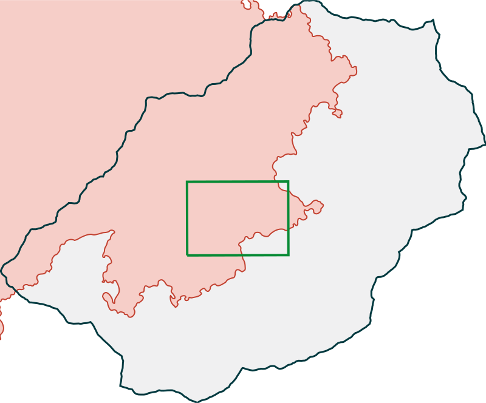
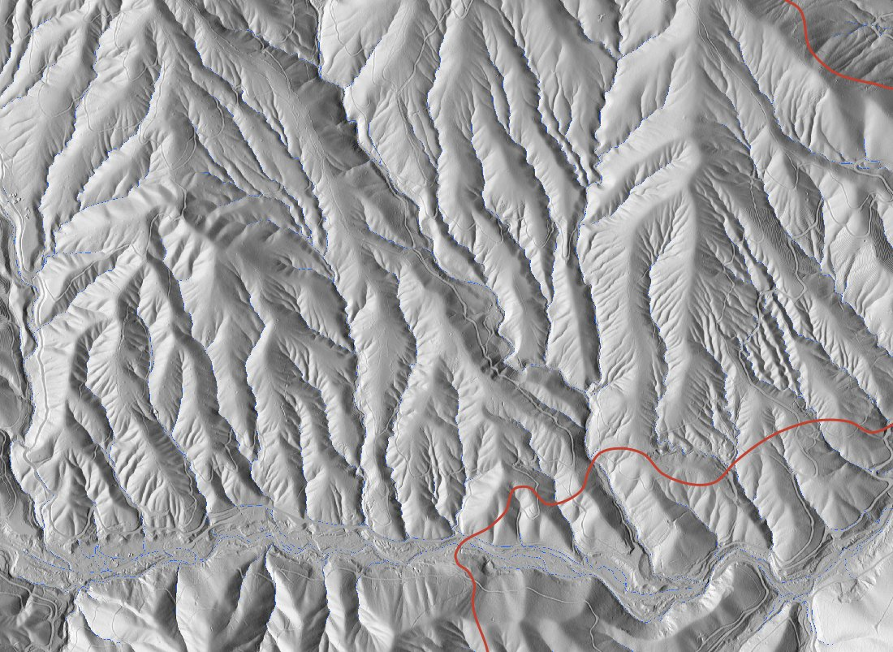
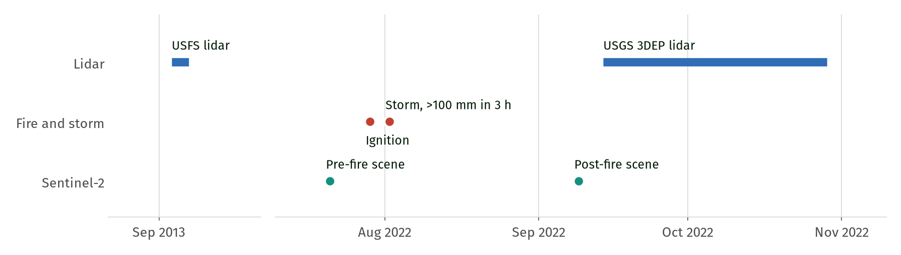
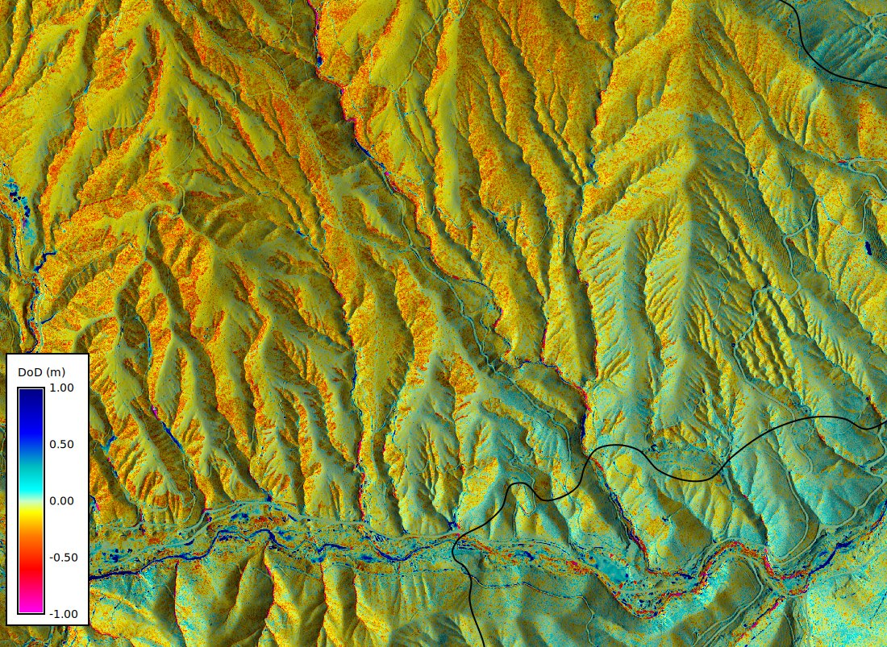
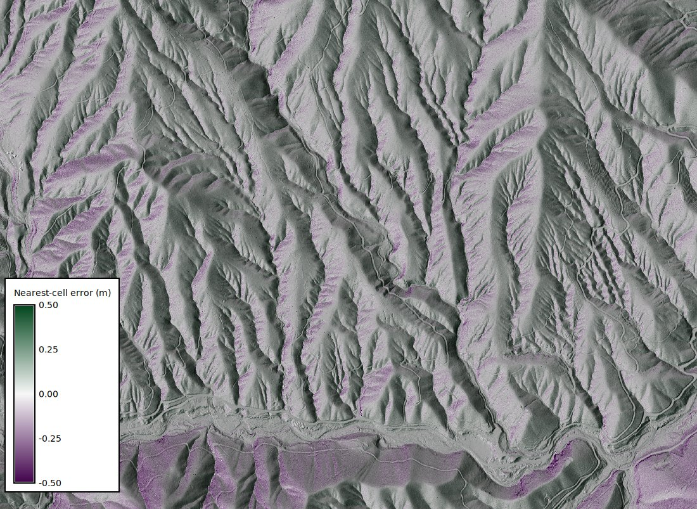
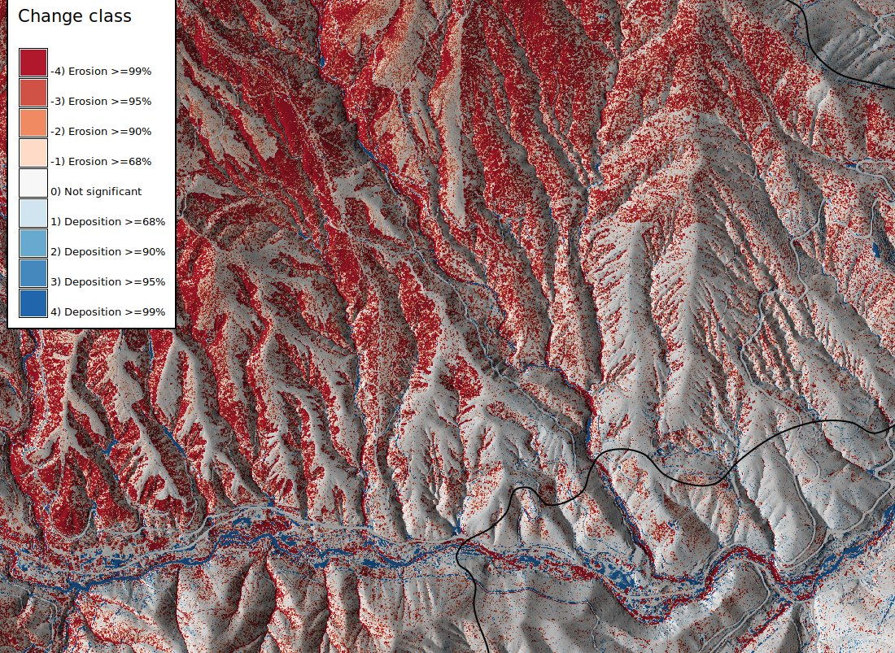
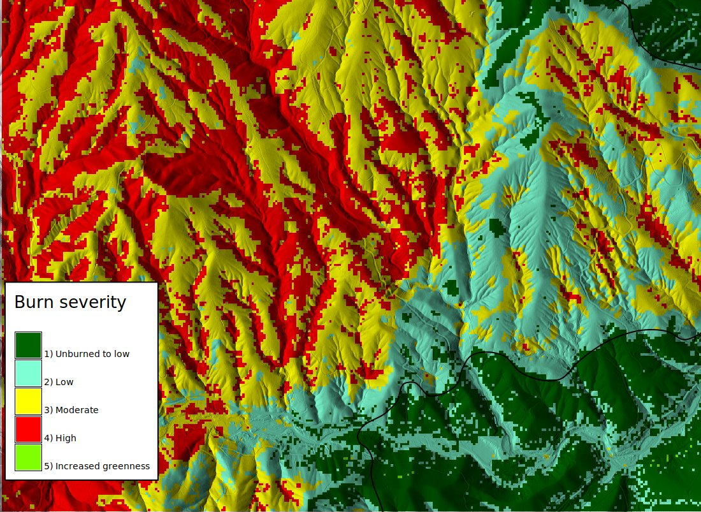
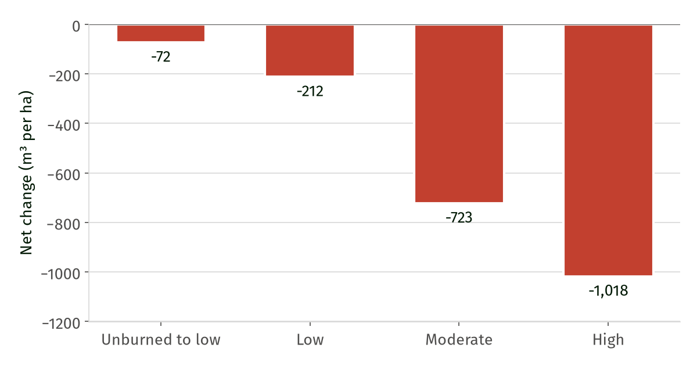

# Geohazard Change Detection for Emergency Management with GRASS {background-color="#00393f" .title-dark}

FOSS4G NA 2026, Sacramento

Corey T. White, Center for Geospatial Analytics, NC State University

{width="320"}

## Today

| Time | Block |
|---|---|
| 13:00 | Setup check |
| 13:15 | Context (these slides) |
| 13:35 | 01. Data, datums, and the temporal framework |
| 14:10 | 02. Co-registration and bias |
| 14:45 | Break |
| 14:55 | 03. Level of detection and significant change |
| 15:30 | 04. Products for emergency management |
| 15:50 | Wrap-up |

Every notebook starts from a checkpoint, so you can rejoin at any block.

## Humbug Creek, California

:::: {.columns}
::: {.column width="48%"}
{width="100%"}
:::
::: {.column width="52%"}
- A tributary of the Klamath River in Siskiyou County, HUC12 180102060801, 96 km²
- Red: the 2022 McKinney Fire perimeter
- Green: our 3.0 x 2.2 km study region, across the fire control line
:::
::::

## The McKinney Fire

:::: {.columns}
::: {.column width="58%"}
{width="100%"}
:::
::: {.column width="42%"}
- Ignited 29 July 2022
- About 60,500 acres in the MTBS record
- Fire-wide, mostly moderate (46%) and high (37%) burn severity
- The control line follows Humbug Creek, so unburned ground sits next to burned channels

[Severity shares from Curtis et al. (2025).]{.source}
:::
::::

## The storm of 2 August 2022

Four days after ignition, monsoonal moisture built a convective thunderstorm over the active fire. It rained hard from 17:30 to 20:30.

- Rainfall rates above 200 mm/h and more than 100 mm in 3 hours over the Humbug and Vesa Creek watersheds
- A 15-minute intensity of 100 mm/h there has a recurrence interval of more than 1000 years
- The storm hit Humbug Creek first and set off sediment-laden flooding
- Rill and gully erosion on burned hillslopes, debris flows that scoured channels, and debris fans in lower-gradient reaches

[Curtis, J.A., et al., 2025. 2022 McKinney rain-on-wildfire event, dissolved oxygen sags, and a fish kill on the Klamath River, California. Scientific Reports 15, 24668. https://doi.org/10.1038/s41598-025-08179-9]{.source}

## Two lidar surveys

{width="100%"}

- USFS lidar, September 2013, distributed by OpenTopography
- USGS 3DEP lidar, 14 September to 28 October 2022, six to twelve weeks after the storm and before the winter rains
- Sentinel-2 scenes before and after the fire give us burn severity

## A DEM of Difference

:::: {.columns}
::: {.column width="58%"}
{width="100%"}
:::
::: {.column width="42%"}
DoD = 2022 DTM minus 2013 DTM, after the co-registration in block 02

- Yellow to red: lowering (erosion)
- Cyan to navy: raising (deposition)
- *r.dem.dod* builds it and checks that both grids line up

The question for the next three hours is how much of this is real.
:::
::::

## Where a raw DoD misleads

| Source of error | What we measure at Humbug Creek |
|---|---|
| Datum realizations | Both files declare EPSG:26910. Applying NADCON5 to 2013 would add a 0.59 m error |
| Geoid models | GEOID12 to GEOID18 moves heights 2 to 3 cm |
| Grid alignment | 2013 cells sit 0.29 m and 0.17 m off the 2022 grid |
| Co-registration | *r.dem.nk* measures 5 cm horizontal and 9 cm vertical between the epochs |
| Vegetation | Burned canopy and understory change what the ground filter keeps |
| Noise | NMAD of 7.6 cm on stable ground |

## The grid offset, made visible

:::: {.columns}
::: {.column width="58%"}
{width="100%"}
:::
::: {.column width="42%"}
The same two DEMs, differenced two ways.

- Nearest cell, which is what *r.mapcalc* does with an offset grid
- Bilinear resampling onto the region

They differ by up to 2 m on steep slopes. Block 01 shows how to catch this.
:::
::::

## Level of detection

0.149 m

The smallest change we will call real, at 95% confidence.

- LoD = 1.96 x NMAD of the DoD on stable ground
- Error grows with slope, from an NMAD of 6 cm below 10 degrees to 11 cm above 40 degrees
- About 11% of stable cells pass a nominal 95% limit, so the limit is optimistic

## Where we are headed: significant change

::::: {.columns}
::: {.column width="62%"}
{width="100%"}
:::
::: {.column width="38%"}
- Each cell gets a z-score, the DoD divided by the uncertainty for its slope
- *r.dem.errprop* turns the z-scores into confidence classes for erosion and deposition
- Built in block 03
:::
:::::

## Burn severity

:::: {.columns}
::: {.column width="58%"}
{width="100%"}
:::
::: {.column width="42%"}
- Sentinel-2 dNBR, 21 July to 9 September 2022
- Classed with the thresholds MTBS published for this fire
- Imported with *t.stac.item* from Earth Search
:::
::::

## Where we are headed: change by burn severity

{width="62%"}

Net change per hectare between 2013 and 2022, above the level of detection. Read it as surface lowering, which includes burned duff, litter, and understory, not only sediment that left.

## The tools

- **GRASS 8.5**, with the temporal framework for the epochs
- **r.dem**, ten tools for co-registration, bias, level of detection, change, and screening, including the new *r.dem.dod*
- **t.stac** for Sentinel-2 through STAC
- All open source in OSGeo/grass-addons. This workshop pins r.dem 1.1.0 ([10.5281/zenodo.23719842](https://doi.org/10.5281/zenodo.23719842))

Materials: <https://github.com/ncsu-geoforall-lab/geohazards-workshop>

## Thanks

- Tim Bailey suggested the Humbug Creek site and the data sources
- Supported by the U.S. National Science Foundation under award 2606178
- Data from USFS Region 5 and OpenTopography ([10.5069/G9FJ2F12](https://doi.org/10.5069/G9FJ2F12)), USGS 3DEP, MTBS, and modified Copernicus Sentinel data 2022

{width="280"}

## Let's start

Open `notebooks/01_data_and_time.ipynb` and run the cells one at a time.
